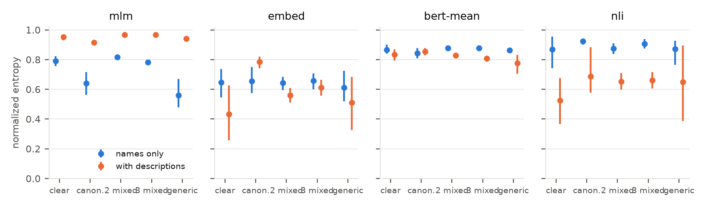
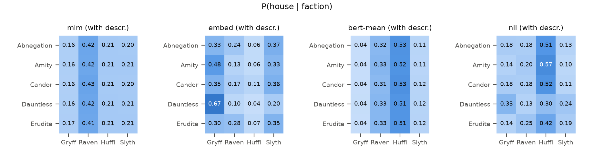

# Divergent: results

Generated by `experiments/divergent.py analyze` from `results/divergent/predictions.csv`. Entropies are normalized (0 = certain, 1 = uniform) and are compared **within a method only**. MLM numbers are the mean over the 3 prompt templates; `tmpl_sd` is the spread of that mean across templates (Jiang et al. 2020). CIs: bootstrap 95%, 1000 resamples over items.

Row counts per test type: clear 11, canonical 4, conflicting 40, divergent_mode 20, generic 3

## 0. Sanity: does the method get the EASY inputs, and does it collapse?

`clear_accuracy`: top-1 accuracy on the 11 single-faction inputs (chance = 0.20); per template for MLM, then averaged. `share_most_common`: how often the single most frequent answer is given across ALL inputs. A value near 1 means the method collapses onto one label, and then entropy and split numbers below describe that label's prior, not the traits.

| labels | method | variant | most_common_pred | share_most_common | clear_accuracy | ci_low | ci_high |
|---|---|---|---|---|---|---|---|
| divergent | bert-mean | names only | erudite | 0.71 | 0.55 | 0.18 | 0.82 |
| divergent | bert-mean | with descriptions | amity | 0.86 | 0.45 | 0.18 | 0.73 |
| divergent | embed | names only | dauntless | 0.51 | 0.55 | 0.27 | 0.82 |
| divergent | embed | with descriptions | amity | 0.47 | 0.55 | 0.27 | 0.82 |
| divergent | mlm | names only | dauntless | 0.55 | 0.21 | 0.06 | 0.36 |
| divergent | mlm | with descriptions | dauntless | 0.58 | 0.24 | 0.09 | 0.45 |
| divergent | nli | names only | candor | 0.56 | 0.45 | 0.18 | 0.73 |
| divergent | nli | with descriptions | erudite | 0.45 | 0.82 | 0.55 | 1.00 |
| hp | bert-mean | names only | ravenclaw | 1.00 |  |  |  |
| hp | bert-mean | with descriptions | hufflepuff | 0.88 |  |  |  |
| hp | embed | names only | gryffindor | 0.91 |  |  |  |
| hp | embed | with descriptions | gryffindor | 0.62 |  |  |  |
| hp | mlm | names only | gryffindor | 0.59 |  |  |  |
| hp | mlm | with descriptions | ravenclaw | 0.73 |  |  |  |
| hp | nli | names only | hufflepuff | 0.97 |  |  |  |
| hp | nli | with descriptions | hufflepuff | 0.69 |  |  |  |

## 1. Entropy by input type

Expected for a model that reads the traits: clear < conflicting < divergent_mode. Generic inputs should also be high.

| method | variant | test_type | n | entropy | ci_low | ci_high | tmpl_sd |
|---|---|---|---|---|---|---|---|
| bert-mean | names only | clear | 11 | 0.87 | 0.84 | 0.90 |  |
| bert-mean | names only | canonical | 4 | 0.84 | 0.81 | 0.88 |  |
| bert-mean | names only | conflicting | 40 | 0.88 | 0.87 | 0.89 |  |
| bert-mean | names only | divergent_mode | 20 | 0.88 | 0.86 | 0.89 |  |
| bert-mean | names only | generic | 3 | 0.86 | 0.85 | 0.88 |  |
| bert-mean | with descriptions | clear | 11 | 0.83 | 0.79 | 0.87 |  |
| bert-mean | with descriptions | canonical | 4 | 0.86 | 0.83 | 0.88 |  |
| bert-mean | with descriptions | conflicting | 40 | 0.83 | 0.81 | 0.84 |  |
| bert-mean | with descriptions | divergent_mode | 20 | 0.81 | 0.79 | 0.83 |  |
| bert-mean | with descriptions | generic | 3 | 0.78 | 0.70 | 0.83 |  |
| embed | names only | clear | 11 | 0.65 | 0.55 | 0.74 |  |
| embed | names only | canonical | 4 | 0.66 | 0.58 | 0.75 |  |
| embed | names only | conflicting | 40 | 0.64 | 0.60 | 0.68 |  |
| embed | names only | divergent_mode | 20 | 0.66 | 0.60 | 0.71 |  |
| embed | names only | generic | 3 | 0.61 | 0.52 | 0.73 |  |
| embed | with descriptions | clear | 11 | 0.43 | 0.26 | 0.63 |  |
| embed | with descriptions | canonical | 4 | 0.79 | 0.74 | 0.82 |  |
| embed | with descriptions | conflicting | 40 | 0.56 | 0.51 | 0.61 |  |
| embed | with descriptions | divergent_mode | 20 | 0.61 | 0.56 | 0.66 |  |
| embed | with descriptions | generic | 3 | 0.51 | 0.33 | 0.68 |  |
| mlm | names only | clear | 11 | 0.79 | 0.76 | 0.82 | 0.13 |
| mlm | names only | canonical | 4 | 0.64 | 0.56 | 0.71 | 0.24 |
| mlm | names only | conflicting | 40 | 0.82 | 0.80 | 0.83 | 0.13 |
| mlm | names only | divergent_mode | 20 | 0.78 | 0.77 | 0.80 | 0.19 |
| mlm | names only | generic | 3 | 0.56 | 0.48 | 0.67 | 0.09 |
| mlm | with descriptions | clear | 11 | 0.95 | 0.93 | 0.97 | 0.01 |
| mlm | with descriptions | canonical | 4 | 0.92 | 0.90 | 0.93 | 0.02 |
| mlm | with descriptions | conflicting | 40 | 0.97 | 0.96 | 0.97 | 0.01 |
| mlm | with descriptions | divergent_mode | 20 | 0.97 | 0.96 | 0.97 | 0.01 |
| mlm | with descriptions | generic | 3 | 0.94 | 0.93 | 0.95 | 0.00 |
| nli | names only | clear | 11 | 0.87 | 0.74 | 0.96 |  |
| nli | names only | canonical | 4 | 0.92 | 0.90 | 0.94 |  |
| nli | names only | conflicting | 40 | 0.87 | 0.84 | 0.91 |  |
| nli | names only | divergent_mode | 20 | 0.91 | 0.87 | 0.94 |  |
| nli | names only | generic | 3 | 0.87 | 0.76 | 0.93 |  |
| nli | with descriptions | clear | 11 | 0.52 | 0.37 | 0.68 |  |
| nli | with descriptions | canonical | 4 | 0.69 | 0.58 | 0.88 |  |
| nli | with descriptions | conflicting | 40 | 0.65 | 0.60 | 0.71 |  |
| nli | with descriptions | divergent_mode | 20 | 0.66 | 0.60 | 0.72 |  |
| nli | with descriptions | generic | 3 | 0.65 | 0.39 | 0.89 |  |

One-sided Mann-Whitney U, Holm-corrected over the whole table:

| method | variant | comparison | diff | U | p | p_holm |
|---|---|---|---|---|---|---|
| bert-mean | names only | conflicting > clear | 0.01 | 234.00 | 0.379 | 1.000 |
| bert-mean | names only | divergent_mode > clear | 0.01 | 121.00 | 0.332 | 1.000 |
| bert-mean | names only | generic > clear | -0.01 | 13.00 | 0.723 | 1.000 |
| bert-mean | with descriptions | conflicting > clear | -0.01 | 182.00 | 0.811 | 1.000 |
| bert-mean | with descriptions | divergent_mode > clear | -0.03 | 73.00 | 0.939 | 1.000 |
| bert-mean | with descriptions | generic > clear | -0.06 | 7.00 | 0.937 | 1.000 |
| embed | names only | conflicting > clear | -0.00 | 203.00 | 0.656 | 1.000 |
| embed | names only | divergent_mode > clear | 0.01 | 108.00 | 0.541 | 1.000 |
| embed | names only | generic > clear | -0.04 | 12.00 | 0.772 | 1.000 |
| embed | with descriptions | conflicting > clear | 0.13 | 271.00 | 0.124 | 1.000 |
| embed | with descriptions | divergent_mode > clear | 0.18 | 141.00 | 0.104 | 1.000 |
| embed | with descriptions | generic > clear | 0.08 | 18.00 | 0.442 | 1.000 |
| mlm | names only | conflicting > clear | 0.03 | 279.00 | 0.090 | 1.000 |
| mlm | names only | divergent_mode > clear | -0.01 | 101.00 | 0.653 | 1.000 |
| mlm | names only | generic > clear | -0.23 | 0.00 | 1.000 | 1.000 |
| mlm | with descriptions | conflicting > clear | 0.01 | 282.00 | 0.080 | 1.000 |
| mlm | with descriptions | divergent_mode > clear | 0.01 | 138.00 | 0.128 | 1.000 |
| mlm | with descriptions | generic > clear | -0.01 | 6.00 | 0.956 | 1.000 |
| nli | names only | conflicting > clear | 0.01 | 209.00 | 0.604 | 1.000 |
| nli | names only | divergent_mode > clear | 0.04 | 100.00 | 0.668 | 1.000 |
| nli | names only | generic > clear | 0.00 | 10.00 | 0.854 | 1.000 |
| nli | with descriptions | conflicting > clear | 0.13 | 267.00 | 0.143 | 1.000 |
| nli | with descriptions | divergent_mode > clear | 0.14 | 132.00 | 0.187 | 1.000 |
| nli | with descriptions | generic > clear | 0.13 | 22.00 | 0.228 | 1.000 |

## 2. Conflicting inputs: pick one or split?

Chance levels: mass on A+B = 0.40, top-2 = {A, B} = 0.10, top-1 in {A, B} = 0.40. `balance` = min/max of P(A), P(B) (1 = even split). `overconfident` = share with max prob > 0.8 (a failure on a mixed input). `first_listed_bonus` = how much more probability the faction gets when its trait comes first (Wilcoxon signed-rank over the pairs).

| method | variant | n | mass_on_AB | ci_low | ci_high | top2_is_AB | top1_in_AB | balance | overconfident | first_listed_bonus | p_order |
|---|---|---|---|---|---|---|---|---|---|---|---|
| bert-mean | names only | 40 | 0.45 | 0.40 | 0.49 | 0.10 | 0.57 | 0.43 | 0.00 | 0.00 | 0.596 |
| bert-mean | with descriptions | 40 | 0.48 | 0.42 | 0.54 | 0.25 | 0.50 | 0.38 | 0.00 | 0.00 | 0.177 |
| embed | names only | 40 | 0.50 | 0.42 | 0.58 | 0.17 | 0.65 | 0.22 | 0.12 | 0.02 | 0.083 |
| embed | with descriptions | 40 | 0.74 | 0.67 | 0.81 | 0.30 | 0.90 | 0.22 | 0.12 | 0.03 | 0.009 |
| mlm | names only | 40 | 0.41 | 0.37 | 0.46 | 0.09 | 0.38 | 0.44 | 0.02 | 0.01 | 0.044 |
| mlm | with descriptions | 40 | 0.42 | 0.40 | 0.43 | 0.12 | 0.52 | 0.67 | 0.00 | 0.00 | 0.019 |
| nli | names only | 40 | 0.54 | 0.49 | 0.58 | 0.20 | 0.70 | 0.43 | 0.00 | 0.01 | 0.009 |
| nli | with descriptions | 40 | 0.75 | 0.70 | 0.80 | 0.47 | 0.95 | 0.27 | 0.10 | -0.04 | 0.001 |

## 3. Divergent mode (three factions at once)

Chance: mass on A+B+C = 0.60, top-3 = {A, B, C} = 0.10.

| method | variant | n | entropy | mass_on_ABC | top3_is_ABC | overconfident |
|---|---|---|---|---|---|---|
| bert-mean | names only | 20 | 0.88 | 0.64 | 0.10 | 0.00 |
| bert-mean | with descriptions | 20 | 0.81 | 0.66 | 0.15 | 0.00 |
| embed | names only | 20 | 0.66 | 0.66 | 0.15 | 0.00 |
| embed | with descriptions | 20 | 0.61 | 0.80 | 0.15 | 0.05 |
| mlm | names only | 20 | 0.78 | 0.61 | 0.08 | 0.05 |
| mlm | with descriptions | 20 | 0.97 | 0.61 | 0.13 | 0.00 |
| nli | names only | 20 | 0.91 | 0.68 | 0.15 | 0.00 |
| nli | with descriptions | 20 | 0.66 | 0.87 | 0.25 | 0.05 |

Tris's aptitude result (selfless + brave + intelligent, and the synonym version):

| method | variant | entropy div-abn-dau-eru-direct | entropy div-abn-dau-eru-syn | mass div-abn-dau-eru-direct | mass div-abn-dau-eru-syn |
|---|---|---|---|---|---|
| bert-mean | names only | 0.86 | 0.89 | 0.89 | 0.87 |
| bert-mean | with descriptions | 0.84 | 0.86 | 0.50 | 0.43 |
| embed | names only | 0.42 | 0.74 | 0.79 | 0.57 |
| embed | with descriptions | 0.63 | 0.72 | 0.83 | 0.70 |
| mlm | names only | 0.77 | 0.74 | 0.62 | 0.68 |
| mlm | with descriptions | 0.98 | 0.96 | 0.61 | 0.68 |
| nli | names only | 0.92 | 0.76 | 0.61 | 0.74 |
| nli | with descriptions | 0.56 | 0.51 | 0.86 | 0.84 |

Canonical characters: Divergent vs. the others (one-sided Mann-Whitney; small n, read as a case study):

| method | variant | n_divergent | entropy_divergent | n_other | entropy_other | p |
|---|---|---|---|---|---|---|
| bert-mean | names only | 2 | 0.84 | 2 | 0.85 | 0.667 |
| bert-mean | with descriptions | 2 | 0.86 | 2 | 0.85 | 0.667 |
| embed | names only | 2 | 0.66 | 2 | 0.65 | 0.667 |
| embed | with descriptions | 2 | 0.77 | 2 | 0.80 | 0.833 |
| mlm | names only | 2 | 0.57 | 2 | 0.71 | 1.000 |
| mlm | with descriptions | 2 | 0.91 | 2 | 0.93 | 0.833 |
| nli | names only | 2 | 0.91 | 2 | 0.94 | 0.833 |
| nli | with descriptions | 2 | 0.58 | 2 | 0.80 | 1.000 |

## 4. Canonical characters: accuracy

Chance = 0.20. Majority baseline (always 'dauntless') = 1.00: the books are mostly about Dauntless, so accuracy must be read against this, and macro-F1 is the fairer number.

| method | variant | n | accuracy | ci_low | ci_high | macro_f1 | tmpl_sd |
|---|---|---|---|---|---|---|---|
| bert-mean | names only | 4 | 0.75 | 0.25 | 1.00 | 0.17 |  |
| bert-mean | with descriptions | 4 | 0.00 | 0.00 | 0.00 | 0.00 |  |
| embed | names only | 4 | 0.75 | 0.25 | 1.00 | 0.17 |  |
| embed | with descriptions | 4 | 0.25 | 0.00 | 0.75 | 0.08 |  |
| mlm | names only | 4 | 0.50 | 0.33 | 0.67 | 0.11 | 0.50 |
| mlm | with descriptions | 4 | 0.67 | 0.67 | 0.67 | 0.13 | 0.58 |
| nli | names only | 4 | 0.00 | 0.00 | 0.00 | 0.00 |  |
| nli | with descriptions | 4 | 0.00 | 0.00 | 0.00 | 0.00 |  |

## 5. Cross-franchise: do factions map onto houses?

Every input is scored with the faction labels AND the house labels. `consistent` = share of inputs whose top house is the one we pre-registered for its top faction (Dauntless->Gryffindor, Erudite->Ravenclaw, Abnegation/Amity->Hufflepuff; Candor inputs are left out). Compare it with `perm_baseline` (house answers shuffled across inputs, 1000 times), not with 0.25: a method that collapses onto one faction and one house gets a high score without any real mapping. `p_perm` = share of shuffles at least as consistent. Tables of P(house | faction) are in `t5_correspondence_*.csv` and the figure `fig_correspondence.png`.

| method | variant | n_inputs | n_scored | consistent | ci_low | ci_high | perm_baseline | p_perm | brave_inputs | brave_to_dauntless_and_gryffindor |
|---|---|---|---|---|---|---|---|---|---|---|
| bert-mean | names only | 78 | 78 | 0.71 | 0.60 | 0.81 | 0.71 | 1.000 | 30 | 0.00 |
| bert-mean | with descriptions | 78 | 75 | 0.81 | 0.72 | 0.91 | 0.81 | 0.589 | 30 | 0.00 |
| embed | names only | 78 | 78 | 0.46 | 0.36 | 0.58 | 0.47 | 0.805 | 30 | 0.60 |
| embed | with descriptions | 78 | 78 | 0.41 | 0.29 | 0.51 | 0.24 | <0.001 | 30 | 0.90 |
| mlm | names only | 78 | 78 | 0.96 | 0.91 | 1.00 | 0.96 | 1.000 | 30 | 1.00 |
| mlm | with descriptions | 78 | 78 | 0.00 | 0.00 | 0.00 | 0.00 | 1.000 | 30 | 0.00 |
| nli | names only | 78 | 34 | 0.00 | 0.00 | 0.00 | 0.00 | 1.000 | 30 | 0.00 |
| nli | with descriptions | 78 | 55 | 0.36 | 0.24 | 0.49 | 0.25 | 0.004 | 30 | 0.10 |

P(house | faction), mlm, with descriptions:

| faction | gryffindor | ravenclaw | hufflepuff | slytherin |
|---|---|---|---|---|
| abnegation | 0.16 | 0.42 | 0.21 | 0.20 |
| amity | 0.16 | 0.42 | 0.21 | 0.21 |
| candor | 0.16 | 0.43 | 0.21 | 0.20 |
| dauntless | 0.16 | 0.42 | 0.21 | 0.21 |
| erudite | 0.17 | 0.41 | 0.21 | 0.21 |

P(house | faction), nli, with descriptions:

| faction | gryffindor | ravenclaw | hufflepuff | slytherin |
|---|---|---|---|---|
| abnegation | 0.18 | 0.18 | 0.51 | 0.13 |
| amity | 0.14 | 0.20 | 0.57 | 0.10 |
| candor | 0.18 | 0.18 | 0.52 | 0.11 |
| dauntless | 0.33 | 0.13 | 0.30 | 0.24 |
| erudite | 0.14 | 0.25 | 0.42 | 0.19 |

## 6. BERT vs. the simulated panel on the Divergent vote items

JSD base 2 (0 = same distribution). The panel is **simulated, not human** (DATA_LOG.md); real form votes are added automatically once `data/human_votes.csv` exists. Per-item rows: `t6_vs_panel.csv`.

| method | variant | reference | type | n | jsd | bert_entropy | ref_entropy |
|---|---|---|---|---|---|---|---|
| bert-mean | names only | simulated panel | clear | 1 | 0.66 | 0.90 | 0.08 |
| bert-mean | names only | simulated panel | conflicting | 2 | 0.21 | 0.88 | 0.56 |
| bert-mean | names only | simulated panel | generic | 3 | 0.57 | 0.86 | 0.23 |
| bert-mean | with descriptions | simulated panel | clear | 1 | 0.46 | 0.86 | 0.08 |
| bert-mean | with descriptions | simulated panel | conflicting | 2 | 0.35 | 0.84 | 0.56 |
| bert-mean | with descriptions | simulated panel | generic | 3 | 0.27 | 0.78 | 0.23 |
| embed | names only | simulated panel | clear | 1 | 0.73 | 0.70 | 0.08 |
| embed | names only | simulated panel | conflicting | 2 | 0.45 | 0.56 | 0.56 |
| embed | names only | simulated panel | generic | 3 | 0.30 | 0.61 | 0.23 |
| embed | with descriptions | simulated panel | clear | 1 | 0.51 | 0.88 | 0.08 |
| embed | with descriptions | simulated panel | conflicting | 2 | 0.24 | 0.36 | 0.56 |
| embed | with descriptions | simulated panel | generic | 3 | 0.21 | 0.51 | 0.23 |
| mlm | names only | simulated panel | clear | 1 | 0.62 | 0.85 | 0.08 |
| mlm | names only | simulated panel | conflicting | 2 | 0.36 | 0.91 | 0.56 |
| mlm | names only | simulated panel | generic | 3 | 0.52 | 0.75 | 0.23 |
| mlm | with descriptions | simulated panel | clear | 1 | 0.53 | 0.91 | 0.08 |
| mlm | with descriptions | simulated panel | conflicting | 2 | 0.29 | 0.99 | 0.56 |
| mlm | with descriptions | simulated panel | generic | 3 | 0.42 | 0.97 | 0.23 |
| nli | names only | simulated panel | clear | 1 | 0.42 | 0.94 | 0.08 |
| nli | names only | simulated panel | conflicting | 2 | 0.20 | 0.86 | 0.56 |
| nli | names only | simulated panel | generic | 3 | 0.35 | 0.87 | 0.23 |
| nli | with descriptions | simulated panel | clear | 1 | 0.27 | 0.80 | 0.08 |
| nli | with descriptions | simulated panel | conflicting | 2 | 0.17 | 0.76 | 0.56 |
| nli | with descriptions | simulated panel | generic | 3 | 0.20 | 0.65 | 0.23 |

## Figures

