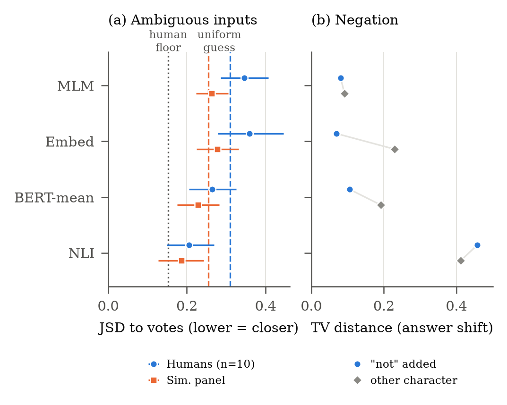

# Q2 and Q3: results (generated by `analysis_q2q3.py`, do not edit by hand)

Worlds with predictions: avatar, divergent, got, hp, invented. Main methods: mlm, embed, bert-mean, nli. Fix methods (mlm-cal, mlm-large, mlm-large-cal) are in the `*_fixes.csv` files only.
References: humans kept = 10 (all = 19), simulated panel kept = 35 (**simulated**, not human).
Choices: DATA_LOG.md, entry "Step 6, Q2 and Q3: analysis choices fixed BEFORE computing them".

## Q2: traits or names?

Target "McNemar p >= 0.05" is formally met in 32 of 32 rows (world x method x variant), but informative (no_name accuracy CI above chance) in only 3. Worlds without no_name / name_swap rows are left out of this count.

| world | method | descriptions | chance | acc_canonical | acc_no_name | acc_name_swap | name_effect | follows_name | mcnemar_p_noname_vs_swap | no_name_above_chance |
|---|---|---|---|---|---|---|---|---|---|---|
| avatar | bert-mean | False | 0.25 | 0.214 | 0.214 | 0.214 | 0.0 | 0.179 | 1.0 | False |
| avatar | bert-mean | True | 0.25 | 0.179 | 0.179 | 0.214 | 0.0 | 0.321 | 1.0 | False |
| avatar | embed | False | 0.25 | 0.286 | 0.179 | 0.179 | 0.107 | 0.286 | 1.0 | False |
| avatar | embed | True | 0.25 | 0.286 | 0.25 | 0.143 | 0.036 | 0.357 | 0.375 | False |
| avatar | mlm | False | 0.25 | 0.107 | 0.214 | 0.214 | -0.107 | 0.357 | 1.0 | False |
| avatar | mlm | True | 0.25 | 0.143 | 0.107 | 0.25 | 0.036 | 0.214 | 0.2188 | False |
| avatar | nli | False | 0.25 | 0.321 | 0.25 | 0.25 | 0.071 | 0.25 | 1.0 | False |
| avatar | nli | True | 0.25 | 0.286 | 0.357 | 0.286 | -0.071 | 0.286 | 0.5 | False |
| got | bert-mean | False | 0.2 | 0.312 | 0.188 | 0.25 | 0.124 | 0.25 | 1.0 | False |
| got | bert-mean | True | 0.2 | 0.125 | 0.062 | 0.062 | 0.063 | 0.062 | 1.0 | False |
| got | embed | False | 0.2 | 0.438 | 0.312 | 0.188 | 0.126 | 0.438 | 0.7266 | False |
| got | embed | True | 0.2 | 0.312 | 0.125 | 0.0 | 0.187 | 0.312 | 0.5 | False |
| got | mlm | False | 0.2 | 0.062 | 0.062 | 0.062 | 0.0 | 0.125 | 1.0 | False |
| got | mlm | True | 0.2 | 0.188 | 0.188 | 0.188 | 0.0 | 0.125 | 1.0 | False |
| got | nli | False | 0.2 | 0.562 | 0.25 | 0.062 | 0.312 | 0.562 | 0.375 | False |
| got | nli | True | 0.2 | 0.438 | 0.188 | 0.188 | 0.25 | 0.188 | 1.0 | False |
| hp | bert-mean | False | 0.25 | 0.235 | 0.235 | 0.235 | 0.0 | 0.235 | 1.0 | False |
| hp | bert-mean | True | 0.25 | 0.353 | 0.294 | 0.353 | 0.059 | 0.147 | 0.625 | False |
| hp | embed | False | 0.25 | 0.412 | 0.324 | 0.412 | 0.088 | 0.265 | 0.5078 | False |
| hp | embed | True | 0.25 | 0.441 | 0.382 | 0.353 | 0.059 | 0.382 | 1.0 | False |
| hp | mlm | False | 0.25 | 0.294 | 0.324 | 0.294 | -0.03 | 0.324 | 1.0 | False |
| hp | mlm | True | 0.25 | 0.235 | 0.235 | 0.235 | 0.0 | 0.176 | 1.0 | False |
| hp | nli | False | 0.25 | 0.529 | 0.382 | 0.353 | 0.147 | 0.294 | 1.0 | False |
| hp | nli | True | 0.25 | 0.5 | 0.5 | 0.412 | 0.0 | 0.235 | 0.25 | True |
| invented | bert-mean | False | 0.25 | 0.219 | 0.188 | 0.25 | 0.031 | 0.156 | 0.625 | False |
| invented | bert-mean | True | 0.25 | 0.438 | 0.531 | 0.469 | -0.093 | 0.188 | 0.7266 | True |
| invented | embed | False | 0.25 | 0.156 | 0.219 | 0.188 | -0.063 | 0.188 | 1.0 | False |
| invented | embed | True | 0.25 | 0.188 | 0.375 | 0.312 | -0.187 | 0.125 | 0.7539 | False |
| invented | mlm | False | 0.25 | 0.25 | 0.25 | 0.312 | 0.0 | 0.219 | 0.625 | False |
| invented | mlm | True | 0.25 | 0.25 | 0.25 | 0.25 | 0.0 | 0.25 | 1.0 | False |
| invented | nli | False | 0.25 | 0.25 | 0.375 | 0.219 | -0.125 | 0.312 | 0.2668 | False |
| invented | nli | True | 0.25 | 0.969 | 0.938 | 0.938 | 0.031 | 0.0 | 1.0 | True |

### Occlusion (mlm, template 0, no name)

| world | descriptions | n_characters | share_any_single_flip | share_top_trait_first | chance | binom_p |
|---|---|---|---|---|---|---|
| avatar | False | 28 | 0.464 | 0.107 | 0.2 | 0.342 |
| avatar | True | 28 | 0.179 | 0.071 | 0.2 | 0.1002 |
| divergent | False | 4 | 0.5 | 0.5 | 0.2 | 0.1808 |
| divergent | True | 4 | 0.0 | 0.25 | 0.2 | 1.0 |
| got | False | 16 | 0.0 | 0.125 | 0.2 | 0.7537 |
| got | True | 16 | 0.625 | 0.125 | 0.2 | 0.7537 |
| hp | False | 34 | 0.618 | 0.265 | 0.2 | 0.3888 |
| hp | True | 34 | 0.088 | 0.235 | 0.2 | 0.667 |
| invented | False | 32 | 0.562 | 0.281 | 0.2 | 0.2677 |
| invented | True | 32 | 0.469 | 0.125 | 0.2 | 0.379 |

## Q3: ambiguity

### JSD to reference votes (pooled over worlds; diff = JSD(model) - JSD(uniform); target met if diff CI < 0)

| reference | method | descriptions | n_items | jsd | jsd_uniform | diff | diff_ci | wilcoxon_p | target_met |
|---|---|---|---|---|---|---|---|---|---|
| humans | bert-mean | False | 20 | 0.362 | 0.31 | 0.052 | -0.017 to 0.116 | 0.9473 | False |
| humans | bert-mean | True | 20 | 0.264 | 0.31 | -0.046 | -0.124 to 0.032 | 0.1559 | False |
| humans | embed | False | 20 | 0.385 | 0.31 | 0.075 | -0.008 to 0.152 | 0.943 | False |
| humans | embed | True | 20 | 0.359 | 0.31 | 0.049 | -0.038 to 0.131 | 0.9053 | False |
| humans | mlm | False | 20 | 0.423 | 0.31 | 0.113 | 0.035 to 0.196 | 0.9852 | False |
| humans | mlm | True | 20 | 0.346 | 0.31 | 0.036 | -0.002 to 0.068 | 0.9867 | False |
| humans | nli | False | 20 | 0.282 | 0.31 | -0.028 | -0.068 to 0.006 | 0.1471 | False |
| humans | nli | True | 20 | 0.206 | 0.31 | -0.103 | -0.156 to -0.050 | 0.0006 | True |
| humans_all19 | bert-mean | False | 20 | 0.24 | 0.18 | 0.06 | 0.014 to 0.104 | 0.9904 | False |
| humans_all19 | bert-mean | True | 20 | 0.169 | 0.18 | -0.011 | -0.075 to 0.053 | 0.4347 | False |
| humans_all19 | embed | False | 20 | 0.277 | 0.18 | 0.097 | 0.027 to 0.168 | 0.9914 | False |
| humans_all19 | embed | True | 20 | 0.266 | 0.18 | 0.086 | 0.026 to 0.149 | 0.9932 | False |
| humans_all19 | mlm | False | 20 | 0.325 | 0.18 | 0.145 | 0.071 to 0.220 | 0.9996 | False |
| humans_all19 | mlm | True | 20 | 0.225 | 0.18 | 0.045 | 0.020 to 0.067 | 0.9988 | False |
| humans_all19 | nli | False | 20 | 0.163 | 0.18 | -0.017 | -0.040 to 0.006 | 0.1081 | False |
| humans_all19 | nli | True | 20 | 0.133 | 0.18 | -0.047 | -0.083 to -0.012 | 0.0133 | True |
| panel | bert-mean | False | 32 | 0.289 | 0.255 | 0.033 | -0.028 to 0.095 | 0.8984 | False |
| panel | bert-mean | True | 32 | 0.228 | 0.255 | -0.027 | -0.081 to 0.029 | 0.1519 | False |
| panel | embed | False | 32 | 0.348 | 0.255 | 0.092 | 0.020 to 0.163 | 0.9953 | False |
| panel | embed | True | 32 | 0.277 | 0.255 | 0.022 | -0.046 to 0.092 | 0.784 | False |
| panel | mlm | False | 32 | 0.383 | 0.255 | 0.128 | 0.063 to 0.192 | 0.9997 | False |
| panel | mlm | True | 32 | 0.263 | 0.255 | 0.007 | -0.025 to 0.036 | 0.8299 | False |
| panel | nli | False | 32 | 0.236 | 0.255 | -0.019 | -0.050 to 0.007 | 0.1475 | False |
| panel | nli | True | 32 | 0.186 | 0.255 | -0.07 | -0.119 to -0.021 | 0.0066 | True |

Human floor (JSD between random halves of the 10 kept humans, 1000 splits): 0.153 (95% of splits: 0.111 to 0.219). Halves of 5 are noisier than the full group, so this floor is on the high side.

### Entropy: ambiguous (generic + conflicting) vs. no_name (Holm-corrected one-sided Mann-Whitney)

| world | method | descriptions | H_ambiguous | H_no_name | H_gap | p_holm | more_uncertain_on_ambiguous |
|---|---|---|---|---|---|---|---|
| avatar | bert-mean | False | 0.599 | 0.521 | 0.078 | 0.3554 | False |
| avatar | bert-mean | True | 0.766 | 0.644 | 0.123 | 0.0006 | True |
| avatar | embed | False | 0.716 | 0.727 | -0.011 | 1.0 | False |
| avatar | embed | True | 0.848 | 0.817 | 0.03 | 1.0 | False |
| avatar | mlm | False | 0.939 | 0.935 | 0.004 | 1.0 | False |
| avatar | mlm | True | 0.855 | 0.783 | 0.071 | 0.0052 | True |
| avatar | nli | False | 0.983 | 0.986 | -0.004 | 1.0 | False |
| avatar | nli | True | 0.792 | 0.832 | -0.04 | 1.0 | False |
| divergent | bert-mean | False | 0.877 |  |  |  | False |
| divergent | bert-mean | True | 0.824 |  |  |  | False |
| divergent | embed | False | 0.641 |  |  |  | False |
| divergent | embed | True | 0.556 |  |  |  | False |
| divergent | mlm | False | 0.906 |  |  |  | False |
| divergent | mlm | True | 0.98 |  |  |  | False |
| divergent | nli | False | 0.874 |  |  |  | False |
| divergent | nli | True | 0.652 |  |  |  | False |
| got | bert-mean | False | 0.915 | 0.886 | 0.029 | 0.3054 | False |
| got | bert-mean | True | 0.838 | 0.833 | 0.005 | 1.0 | False |
| got | embed | False | 0.837 | 0.816 | 0.021 | 1.0 | False |
| got | embed | True | 0.618 | 0.556 | 0.062 | 1.0 | False |
| got | mlm | False | 0.804 | 0.804 | 0.001 | 1.0 | False |
| got | mlm | True | 0.905 | 0.897 | 0.008 | 1.0 | False |
| got | nli | False | 0.979 | 0.982 | -0.003 | 1.0 | False |
| got | nli | True | 0.812 | 0.76 | 0.052 | 1.0 | False |
| hp | bert-mean | False | 0.674 | 0.582 | 0.092 | 0.0415 | True |
| hp | bert-mean | True | 0.777 | 0.827 | -0.05 | 1.0 | False |
| hp | embed | False | 0.751 | 0.753 | -0.002 | 1.0 | False |
| hp | embed | True | 0.744 | 0.669 | 0.075 | 0.4292 | False |
| hp | mlm | False | 0.756 | 0.787 | -0.031 | 1.0 | False |
| hp | mlm | True | 0.929 | 0.938 | -0.009 | 1.0 | False |
| hp | nli | False | 0.963 | 0.962 | 0.001 | 1.0 | False |
| hp | nli | True | 0.839 | 0.833 | 0.006 | 1.0 | False |
| invented | bert-mean | False | 0.862 | 0.81 | 0.052 | 0.0332 | True |
| invented | bert-mean | True | 0.808 | 0.894 | -0.086 | 1.0 | False |
| invented | embed | False | 0.732 | 0.677 | 0.054 | 1.0 | False |
| invented | embed | True | 0.703 | 0.683 | 0.02 | 1.0 | False |
| invented | mlm | False | 0.742 | 0.754 | -0.011 | 1.0 | False |
| invented | mlm | True | 0.95 | 0.923 | 0.027 | 0.0007 | True |
| invented | nli | False | 0.998 | 0.998 | -0.0 | 1.0 | False |
| invented | nli | True | 0.794 | 0.635 | 0.158 | 0.0004 | True |

### Negation (negation row vs. the same character's no_name row)

| world | method | descriptions | n_pairs | flip_rate | tv_negation | tv_other_character | ratio | H_negation |
|---|---|---|---|---|---|---|---|---|
| avatar | bert-mean | False | 28 | 0.0 | 0.122 | 0.092 | 1.32 | 0.319 |
| avatar | bert-mean | True | 28 | 0.25 | 0.151 | 0.154 | 0.98 | 0.716 |
| avatar | embed | False | 28 | 0.036 | 0.054 | 0.208 | 0.26 | 0.722 |
| avatar | embed | True | 28 | 0.107 | 0.066 | 0.224 | 0.29 | 0.777 |
| avatar | mlm | False | 28 | 0.464 | 0.135 | 0.191 | 0.71 | 0.961 |
| avatar | mlm | True | 28 | 0.25 | 0.078 | 0.116 | 0.67 | 0.825 |
| avatar | nli | False | 28 | 0.357 | 0.064 | 0.062 | 1.03 | 0.986 |
| avatar | nli | True | 28 | 0.821 | 0.423 | 0.35 | 1.21 | 0.868 |
| got | bert-mean | False | 16 | 0.312 | 0.105 | 0.141 | 0.75 | 0.911 |
| got | bert-mean | True | 16 | 0.125 | 0.097 | 0.195 | 0.5 | 0.847 |
| got | embed | False | 16 | 0.188 | 0.06 | 0.184 | 0.33 | 0.809 |
| got | embed | True | 16 | 0.0 | 0.067 | 0.151 | 0.44 | 0.605 |
| got | mlm | False | 16 | 0.0 | 0.056 | 0.092 | 0.61 | 0.816 |
| got | mlm | True | 16 | 0.0 | 0.075 | 0.074 | 1.01 | 0.878 |
| got | nli | False | 16 | 0.875 | 0.1 | 0.095 | 1.05 | 0.979 |
| got | nli | True | 16 | 0.625 | 0.416 | 0.417 | 1.0 | 0.774 |
| hp | bert-mean | False | 34 | 0.0 | 0.099 | 0.131 | 0.75 | 0.698 |
| hp | bert-mean | True | 34 | 0.176 | 0.069 | 0.161 | 0.43 | 0.832 |
| hp | embed | False | 34 | 0.029 | 0.042 | 0.223 | 0.19 | 0.743 |
| hp | embed | True | 34 | 0.118 | 0.075 | 0.314 | 0.24 | 0.679 |
| hp | mlm | False | 34 | 0.0 | 0.112 | 0.111 | 1.01 | 0.677 |
| hp | mlm | True | 34 | 0.118 | 0.087 | 0.112 | 0.78 | 0.903 |
| hp | nli | False | 34 | 0.706 | 0.149 | 0.134 | 1.11 | 0.982 |
| hp | nli | True | 34 | 0.941 | 0.384 | 0.336 | 1.14 | 0.891 |
| invented | bert-mean | False | 32 | 0.188 | 0.039 | 0.086 | 0.46 | 0.796 |
| invented | bert-mean | True | 32 | 0.25 | 0.105 | 0.256 | 0.41 | 0.947 |
| invented | embed | False | 32 | 0.125 | 0.083 | 0.206 | 0.4 | 0.724 |
| invented | embed | True | 32 | 0.094 | 0.067 | 0.228 | 0.29 | 0.7 |
| invented | mlm | False | 32 | 0.062 | 0.075 | 0.134 | 0.56 | 0.709 |
| invented | mlm | True | 32 | 0.031 | 0.083 | 0.064 | 1.29 | 0.935 |
| invented | nli | False | 32 | 0.531 | 0.029 | 0.033 | 0.87 | 0.998 |
| invented | nli | True | 32 | 1.0 | 0.606 | 0.543 | 1.12 | 0.885 |

### Calibration pull (original mlm): share of rows given the most common answer

| world | descriptions | scores | input | most_common | n | share_most_common |
|---|---|---|---|---|---|---|
| avatar | False | raw | no_name | earth | 28 | 1.0 |
| avatar | False | raw | generic | earth | 25 | 1.0 |
| avatar | False | calibrated | no_name | fire | 28 | 0.607 |
| avatar | False | calibrated | generic | fire | 25 | 0.48 |
| avatar | True | raw | no_name | earth | 28 | 0.5 |
| avatar | True | raw | generic | earth | 25 | 1.0 |
| avatar | True | calibrated | no_name | air | 28 | 0.571 |
| avatar | True | calibrated | generic | air | 25 | 0.92 |
| divergent | False | raw | generic | amity | 3 | 0.667 |
| divergent | False | calibrated | generic | dauntless | 3 | 1.0 |
| divergent | True | raw | generic | dauntless | 3 | 0.667 |
| divergent | True | calibrated | generic | dauntless | 3 | 1.0 |
| got | False | raw | no_name | stark | 16 | 1.0 |
| got | False | raw | generic | stark | 25 | 1.0 |
| got | False | calibrated | no_name | tyrell | 16 | 1.0 |
| got | False | calibrated | generic | tyrell | 25 | 0.76 |
| got | True | raw | no_name | stark | 16 | 1.0 |
| got | True | raw | generic | stark | 25 | 0.88 |
| got | True | calibrated | no_name | greyjoy | 16 | 1.0 |
| got | True | calibrated | generic | greyjoy | 25 | 0.96 |
| hp | False | raw | no_name | gryffindor | 34 | 1.0 |
| hp | False | raw | generic | gryffindor | 25 | 1.0 |
| hp | False | calibrated | no_name | gryffindor | 34 | 0.971 |
| hp | False | calibrated | generic | gryffindor | 25 | 1.0 |
| hp | True | raw | no_name | gryffindor | 34 | 1.0 |
| hp | True | raw | generic | gryffindor | 25 | 1.0 |
| hp | True | calibrated | no_name | ravenclaw | 34 | 0.882 |
| hp | True | calibrated | generic | ravenclaw | 25 | 0.84 |
| invented | False | raw | no_name | osmark | 32 | 1.0 |
| invented | False | raw | generic | osmark | 25 | 1.0 |
| invented | False | calibrated | no_name | calwen | 32 | 0.875 |
| invented | False | calibrated | generic | calwen | 25 | 1.0 |
| invented | True | raw | no_name | osmark | 32 | 0.312 |
| invented | True | raw | generic | osmark | 25 | 0.88 |
| invented | True | calibrated | no_name | durrask | 32 | 1.0 |
| invented | True | calibrated | generic | durrask | 25 | 0.72 |

